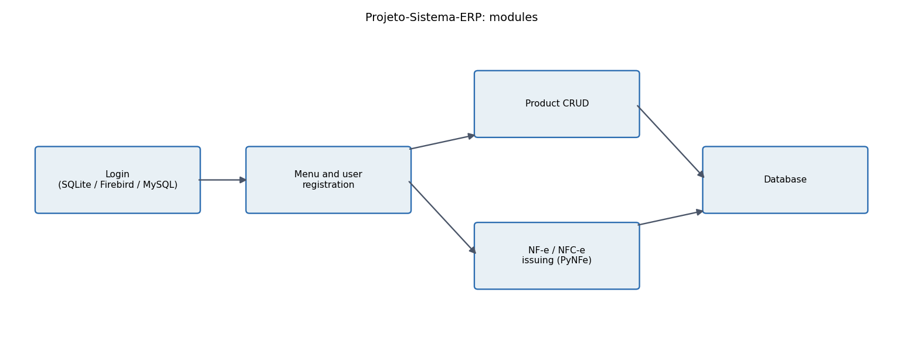
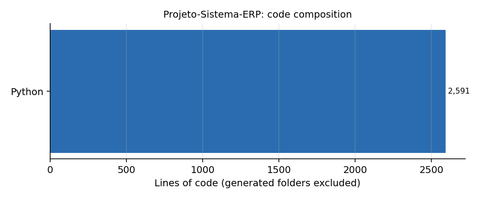

# Projeto-Sistema-ERP

**Desktop commercial-automation system in Python 2.7: login, product registration, user management and electronic invoice (NF-e / NFC-e) issuing.** An early ERP prototype with a database-agnostic data layer (SQLite by default, Firebird or MySQL with their clients). *Em portugues: sistema de automacao comercial com cadastro de produtos, usuarios e emissao de NF-e.*

## Modules

| File | What it does |
|---|---|
| `Entrar.pyw` | Login screen (Tkinter). The database in use is configured in the login and menu classes |
| `Menu e Cadastro de usuarios.pyw` | Main menu and user registration |
| `Cadastro de produtos.py` | Product CRUD with input validation (numeric and code fields, focus-out checks), combo boxes filled from the database, save button; connects to SQLite (`Cadastro.db`) or Firebird (`CADASTRO.FDB`, via `fdb`) |
| `Enviar NFE.py` | Issues an NF-e in the SEFAZ homologation environment with `PynFe`: issuer, customer, items, XML serialization and A1 certificate signing (all identifiers in the file are the library's documented sample values) |
| `Calculadora.py` | Small calculator widget |
| `Projeto Eclipse/` | The same code as an Eclipse/PyDev project |

`README.txt` (in Portuguese) is the original user tutorial: SQLite is the default, Firebird and MySQL need their client libraries, and the CRUD plus NF-e and NFC-e sending are implemented while the GUI for invoicing is not.

## Status

Early prototype. Python 2.7, Tkinter and PynFe of that time; it would need porting to run on current Python. A good reference for the shape of a small ERP: data access abstraction, validated forms and fiscal document issuing in a test environment.
